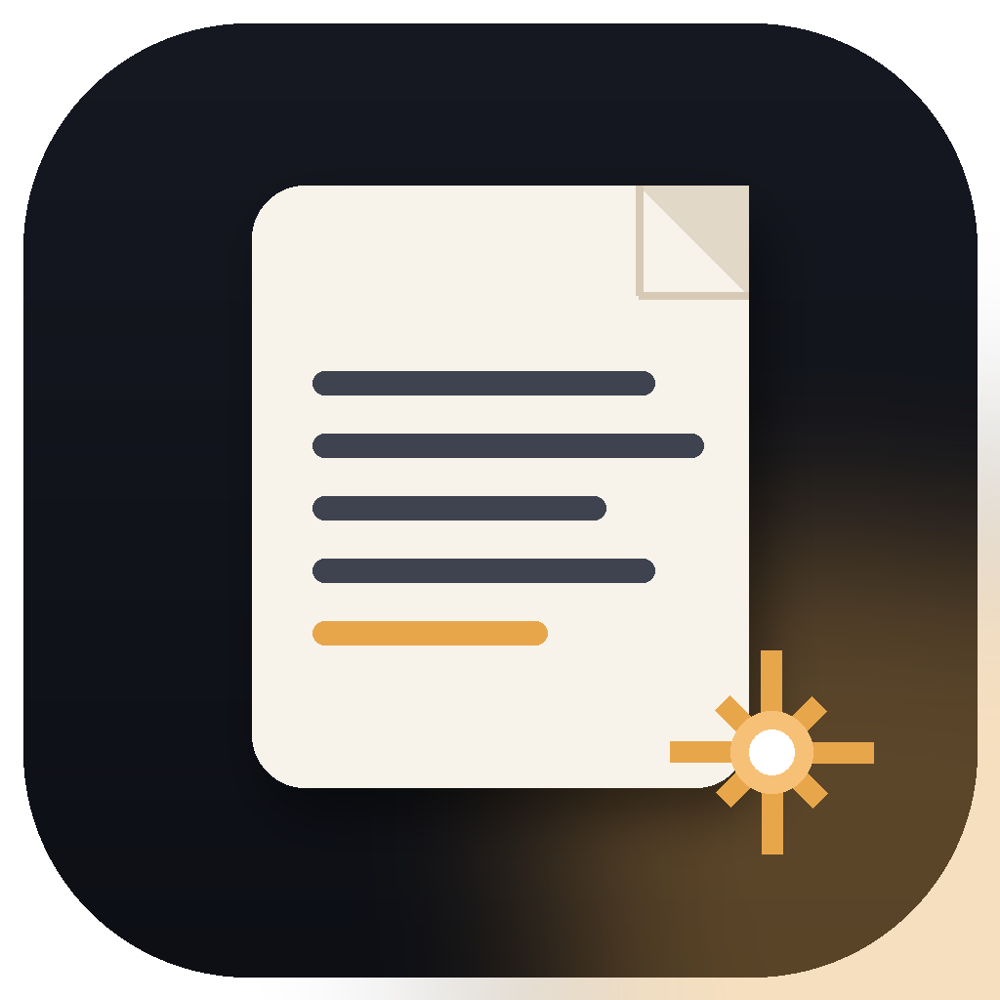
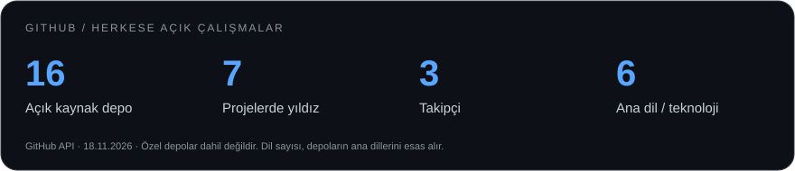

  

  # Mert Harmankaşı

  

    

  

---

## 📌 Öne Çıkan Projeler

<table>
<tr>
<td width="50%" align="center">

<h3><a href="https://github.com/Whitich/Notra">Notra</a></h3>

Windows için yerel öncelikli not, çizim ve tablo uygulaması.

<strong>Python · SQLite · pywebview</strong>

<a href="https://github.com/Whitich/Notra/releases/latest">İndir</a> · <a href="https://github.com/Whitich/Notra">Kaynak kod</a>

</td>
<td width="50%" align="center">

<h3><a href="https://github.com/Whitich/DiskMap">DiskMap</a></h3>

Disk kullanımını görselleştir; büyük ve kopya dosyaları bul.

<strong>C# · .NET · WPF</strong>

<a href="https://github.com/Whitich/DiskMap/releases/latest">İndir</a> · <a href="https://github.com/Whitich/DiskMap">Kaynak kod</a>

</td>
</tr>
</table>

---

## 📊 İstatistikler

---

## 🎯 Başarımlar

<a href="https://github.com/Whitich?tab=achievements">
<!-- ACHIEVEMENTS:START -->
  
  
  
<!-- ACHIEVEMENTS:END -->
</a>

<a href="https://github.com/Whitich?tab=achievements">Güncel başarımlar ve seviyeler →</a>

---

## 🐍 Etkinlik

  

---

  

